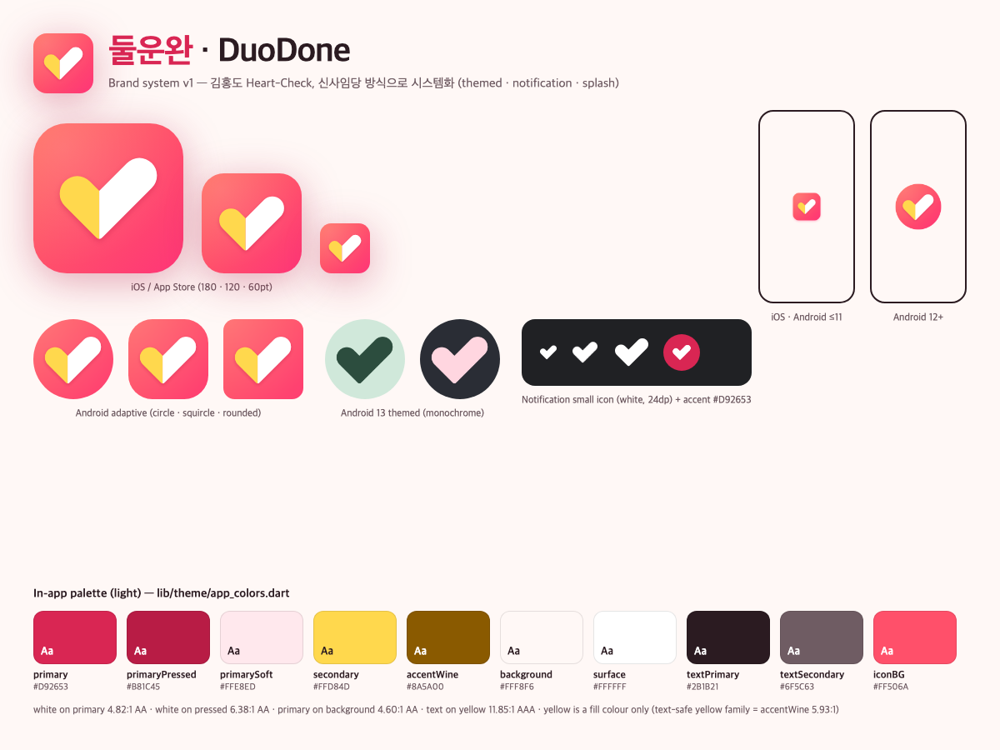
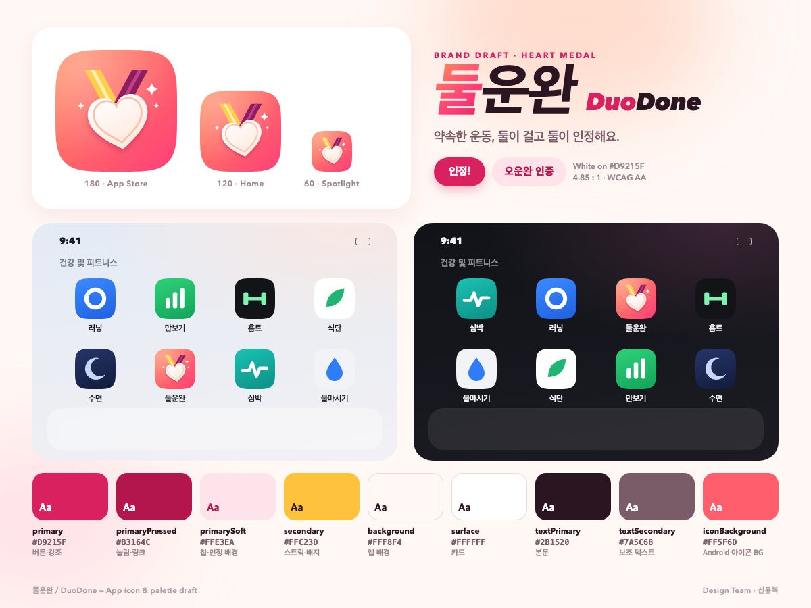
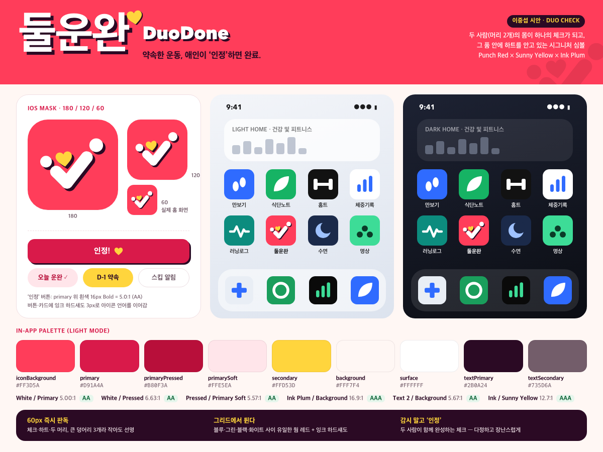
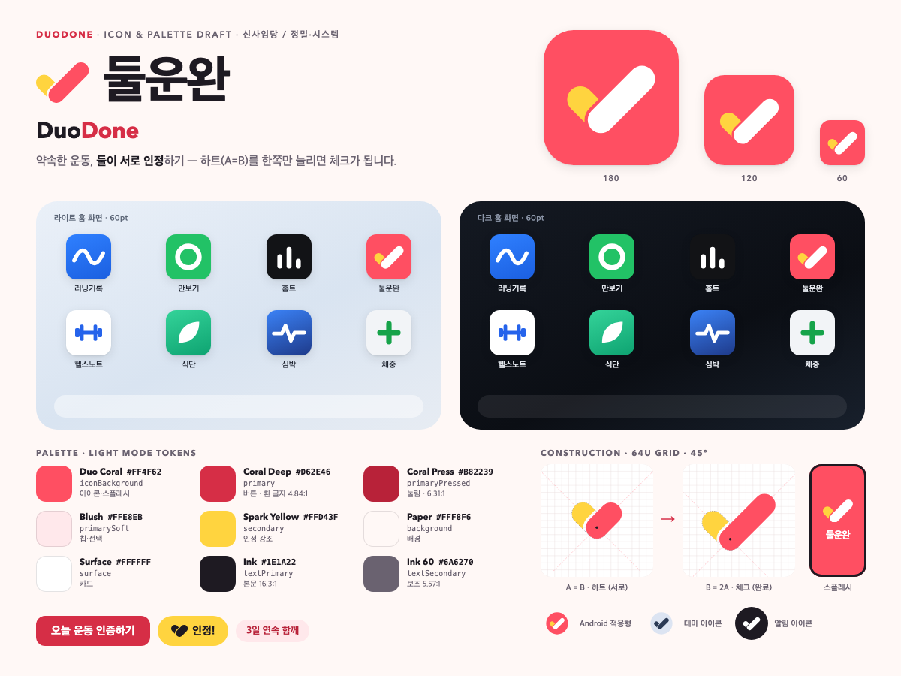
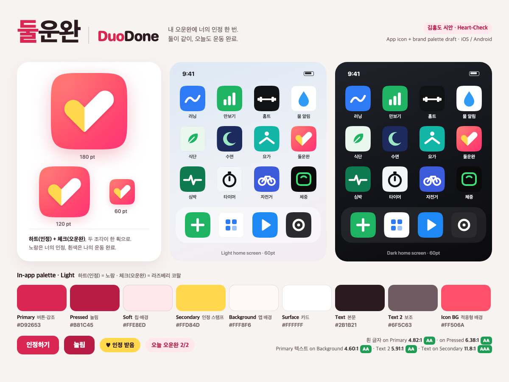

<!-- COMMIT_STATUS START -->
> **커밋 상태**
> - 기준 커밋: `ca33b3afce18d181a507f9c3b524991d4fdbb21a` (`feat/couple-workout-pivot`)
> - 최근 커밋: `ca33b3afce18` docs: 둘운완 pivot spec, decision D-007, launch plan and runbook
> - 커밋 일시: `2026-10-03T07:18:28+09:00`
> - 워킹트리: `dirty (5 files)`
> - 문서 갱신: `2026-10-03 07:18:56 +0900`
<!-- COMMIT_STATUS END -->

# 둘운완 / DuoDone 브랜드 가이드

> 2026-10-02 · 디자인팀(신윤복 / 디자인실장) · 정본 스펙: `docs/product/PIVOT_DUOUNWAN_SPEC.md` 1절 · 결정: `docs/decisions/DECISIONS.md` D-007
> 대표 검토용 문서예요. 다른 시안으로 바꾸고 싶으면 맨 아래 "시안 교체 방법"을 보세요.

## 1. 선택한 방향: 김홍도 **Heart-Check**

- **형태:** 굵은 90° 획 하나로 그린 체크예요. 짧은 왼팔은 하트의 한쪽 볼록, 긴 오른팔은 체크의 긴 획으로 읽혀요. 꼭짓점을 세로로 나눠 두 색을 칠했어요.
- **의미:** 노란 반쪽은 짝꿍의 인정, 흰 반쪽은 나의 오운완이에요. 두 조각이 합쳐져 체크 하나가 되니 "둘 다 오늘 운동 완료 = 둘운완"이에요.
- **선정 이유**
  1. 60pt 홈 화면에서도 하트와 체크가 한눈에 읽혀요. 건강·피트니스 그리드(파랑·초록·검정)에서 코랄 그라데이션이 눈에 띄어요.
  2. "인정"(노랑)이라는 핵심 행동이 아이콘 안에 들어 있어서 앱 안의 인정 버튼·배지와 색 언어가 이어져요.
  3. 형태가 단순해 모노크롬(Android 13 테마 아이콘)·알림 아이콘·스플래시로 줄여도 정체성이 남아요.
- **시스템화:** 신사임당 시안의 방식(테마 아이콘, 알림 아이콘, 스플래시)을 따랐어요.

## 2. 팔레트 토큰 (라이트, 단일 고정)

코드 정본은 `lib/theme/app_colors.dart`의 `_smokyPlumPalette`예요. 기존 사용자 prefs 호환을 위해 enum 키 이름 `smokyPlum`은 그대로 두었어요. 시작 시 항상 이 팔레트를 쓰고(`lib/providers/app_settings_provider.dart`), 나머지 4개 팔레트는 숨겨진 레거시예요.

| 토큰 | 값 | 용도 | 대비 |
|---|---|---|---|
| primary | `#D92653` | 버튼·강조·"지금" 칩 | 흰 글자 4.82:1 AA, 배경 위 4.60:1 AA |
| primaryPressed | `#B81C45` | 눌림, primarySoft 위 진한 글자 | 흰 글자 6.38:1, soft 위 5.48:1 |
| primarySoft | `#FFE8ED` | 칩·선택 배경 | |
| secondary (인정 옐로) | `#FFD84D` | **채움 전용**: 인정 배지, 보조 버튼 | 위에 textPrimary 11.85:1 AAA. 흰 배경 위 글자로 쓰면 1.38:1 ❌ |
| accentWine (honey) | `#8A5A00` | 옐로 계열 글자·아이콘 | 흰 배경 5.93:1 AA |
| accentInkViolet | `#FFF6D6` | 옅은 옐로 힌트 배경 | |
| background | `#FFF8F6` | 앱 배경, 네이티브 스플래시 | |
| surface | `#FFFFFF` | 카드 | |
| textPrimary | `#2B1B21` | 본문 | 배경 위 15.6:1 |
| textSecondary | `#6F5C63` | 보조 글자 | 배경 위 5.91:1 AA |
| textDisabled | `#A8969C` | 비활성 글자 | |
| outline / divider | `#EADADD` / `#F3E7E9` | 테두리·구분선 | |
| warningSoft / Border / Strong | `#FFF1E8` / `#E0612A` / `#A3410F` | 내기·경고 칩(핑크와 구분되는 오렌지) | Strong on Soft 5.72:1 |
| notice Bg / Border / Text | `#FFF7DB` / `#FFD84D` / `#5C4210` | 게스트 안내 배너 | 8.73:1 |
| restTone | `#9DB0E0` | 휴식 셀(차가운 톤) | |
| pendingBadge Fill / Text | 20% `#FFD84D` / `#8A5A00` | 승인 대기 배지(레거시) | 5.53:1 |
| 아이콘 그라데이션 | `#FF6B5E → #FF3577` (↘) | 아이콘·피처 그래픽 배경 | 단색 대체 `#FF506A` |
| 알림 색 | `#D92653` | Android 알림 accent | |

## 3. 아이콘 파일

| 파일 | 내용 | 쓰는 곳 |
|---|---|---|
| `assets/brand/icon_1024.png` | 불투명, 꽉 찬 사각(둥근 모서리 없음) 마스터 | flutter_launcher_icons `image_path`(iOS·레거시 Android·웹) |
| `assets/brand/icon_background.png` | 그라데이션 + 좌상단 글로우 | Android 적응형 배경 |
| `assets/brand/icon_foreground.png` | 투명, 마크가 66dp 안전 영역 안(외접원 r=270/1024) | Android 적응형 전경(`inset 0%`) |
| `assets/brand/icon_monochrome.png` | 한 덩어리 실루엣(검정, 알파만 사용) | Android 13 테마 아이콘 |
| `assets/brand/splash_logo.png` | 512 캔버스, 384px 둥근 타일(=96pt @4x) + 그림자 | iOS·Android ≤11 네이티브 스플래시 |
| `assets/brand/splash_android12.png` | 1152 캔버스, 중앙 2/3 원 안에 그라데이션 원 + 마크 | Android 12+ 스플래시 |
| `assets/brand/svg/*.svg` | 위 파일들의 벡터 원본 + `ic_stat_duodone.svg` | 수정·재출력용 |
| `assets/images/app_icon.png` | 512 둥근 타일(투명 모서리) | 앱 안 로고(스플래시 화면·로그인) |
| `android/app/src/main/res/drawable-*/ic_stat_duodone.png` | 흰색 실루엣, 24dp(2dp 여백) | 알림 작은 아이콘, FCM 기본 아이콘 |
| `android/fastlane/metadata/android/*/images/icon.png` | 512 불투명 | Play 스토어 아이콘 |
| `android/fastlane/metadata/android/*/images/featureGraphic.png` | 1024×500, ko `둘이 보면, 진짜 하게 돼요` / en `Workouts you actually do, together` | Play 피처 그래픽 |

다시 만들기: `python3 docs/design/brand-build/build.py`(마스터·알림 아이콘), `python3 docs/design/brand-build/graphics.py`(피처 그래픽·이 문서의 시트). Chrome headless와 Pillow가 필요해요. 결과는 `docs/design/brand-build/out/`에 생겨요. 그 뒤 `dart run flutter_launcher_icons`, `dart run flutter_native_splash:create`를 실행해요(설정: `pubspec.yaml`).

## 4. 사용 규칙

- **이름:** 한국어 `둘운완`, 영어 `DuoDone`. 기기 표시명도 같아요(iOS `InfoPlist.strings`, Android `res/values{,-ko}/strings.xml`). 스토어 이름은 같은 토큰을 꼭 포함해야 해요(App Store 2.3.8).
- **마크 방향:** 노랑(인정)은 왼쪽, 흰색(오운완)은 오른쪽이에요. 좌우를 뒤집거나 색을 바꾸지 마세요.
- **마크 배경:** 마크는 코랄 그라데이션(또는 `#FF506A`) 위에만 올려요. 흰 반쪽이 사라지므로 밝은 배경 위에 마크만 올리지 말고, 둥근 타일째 쓰세요.
- **여백:** 타일 안 마크 bbox는 타일의 약 65%(iOS 마스터 기준 664/1024)예요. Android 원형 마스크용은 더 작게 두었어요.
- **옐로는 채움 색:** `#FFD84D` 위에는 `#2B1B21` 글자를 써요. 흰 배경 위 옐로 글자는 쓰지 말고 `accentWine #8A5A00`을 쓰세요.
- **단색 사용:** 테마 아이콘·알림처럼 한 색만 될 때는 두 조각이 붙은 실루엣(`icon_monochrome`)을 써요.
- **금지:** 아이콘에 둥근 모서리를 굽지 마세요(iOS·Android가 직접 잘라요). 마크에 테두리·외곽선·3D 효과를 더하지 마세요.

## 5. 다른 3개 시안 (교체 후보)

| 시안 | 미리보기 | 요약 |
|---|---|---|
| 신윤복 · Heart Medal |  | 리본 메달에 하트. 그라데이션 `#FF8E5E → #FF3E78`. 보상·성취 느낌이 강하지만 작은 크기에서 디테일(리본·반짝이)이 뭉개져요. |
| 이중섭 · Duo Check |  | 두 사람(머리 2개)의 몸이 체크가 되고 품에 노란 하트. `#FF3D5A` 단색 + 잉크 하드섀도. 장난스럽고 개성 강함, 요소가 많아 모노크롬화가 어려워요. |
| 신사임당 · Heart→Check |  | 하트(A)를 한쪽만 늘리면 체크(B). `#FF4F62` 단색, 64u 그리드. 가장 정돈된 시스템(테마·알림·스플래시)이라 이 방식을 채택안 시스템화에 썼어요. |
| **김홍도 · Heart-Check (채택)** |  | 위 1절. |

## 6. 시안 교체 방법

1. 새 시안의 `icon.svg`(불투명 1024), 전경(투명, 외접원 r≤313), 모노크롬 SVG를 `assets/brand/svg/`에 넣고 PNG로 출력해 `assets/brand/`의 같은 파일명으로 덮어써요(또는 `brand-build/build.py`의 `mark_group` 부분을 교체).
2. `dart run flutter_launcher_icons` → `dart run flutter_native_splash:create` 실행 후 `ios/Runner/Info.plist`가 들여쓰기만 바뀌었으면 되돌려요.
3. `assets/images/app_icon.png`(512 둥근 타일), 알림 아이콘, Play `icon.png`·`featureGraphic.png`를 다시 출력해요.
4. 팔레트가 바뀌면 `lib/theme/app_colors.dart`, `pubspec.yaml`의 스플래시·웹 색, `android/app/src/main/res/values/colors.xml`, `privacy-policy`·`support` 페이지 색을 같이 바꿔요.
